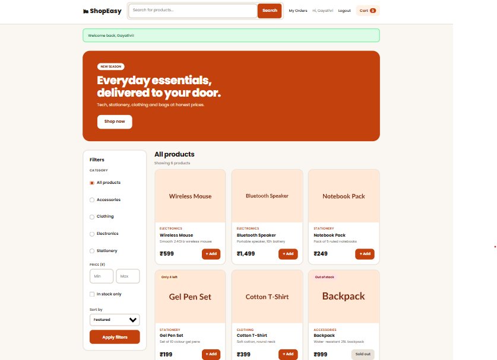
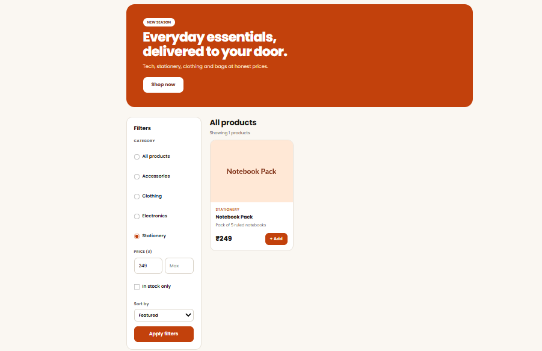
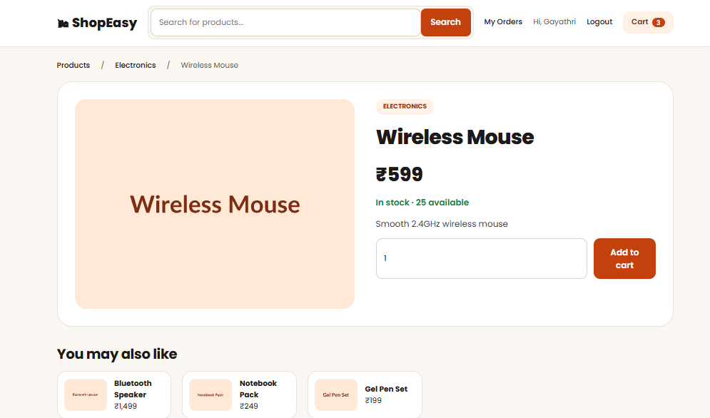
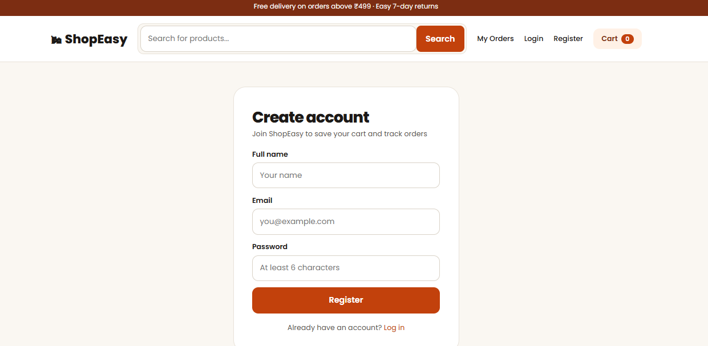
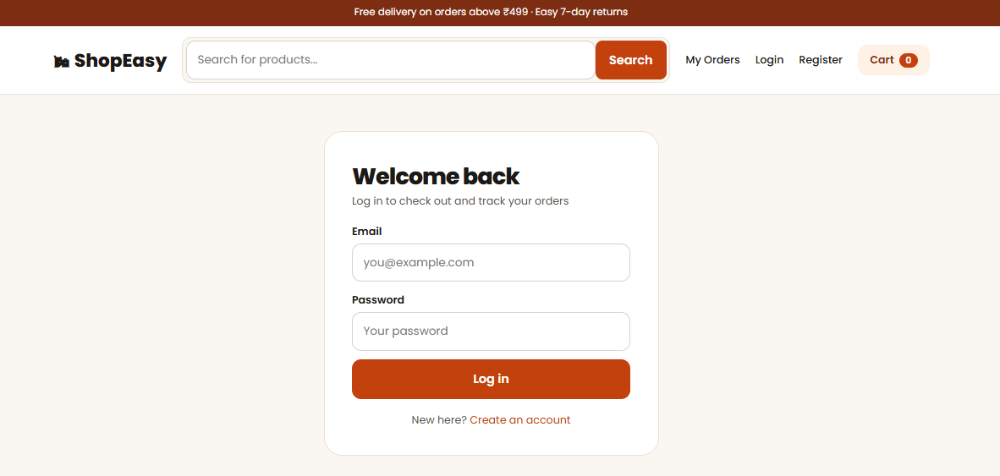

# ShopEasy - E-Commerce Website

A full-stack e-commerce web application built with **Flask** and **SQLite**.

## Features
- Product catalog with search, category filter, price filter and sorting
- Product details page
- Shopping cart (add, update, remove)
- User accounts (register, login, logout)
- Checkout and order history
- Admin panel to manage products and order status
- JSON API for product management

## Tech Stack
- Python, Flask
- SQLite
- HTML, CSS (Jinja templates)

## Screenshots

### Home Page


### Filter and Search


### Product Details


### Register


### Login


## How to Run

1. Install Flask
```
pip install flask
```

2. Create the database
```
python init_db.py
```

3. Start the app
```
python app.py
```

4. Open http://127.0.0.1:5000

**Admin login:** `admin@shop.com` / `admin123`

## Project Structure
```
ecommerce/
├── app.py
├── init_db.py
├── schema.sql
├── static/
│   └── style.css
├── templates/
└── screenshots/
```

## Author
Gayathri R